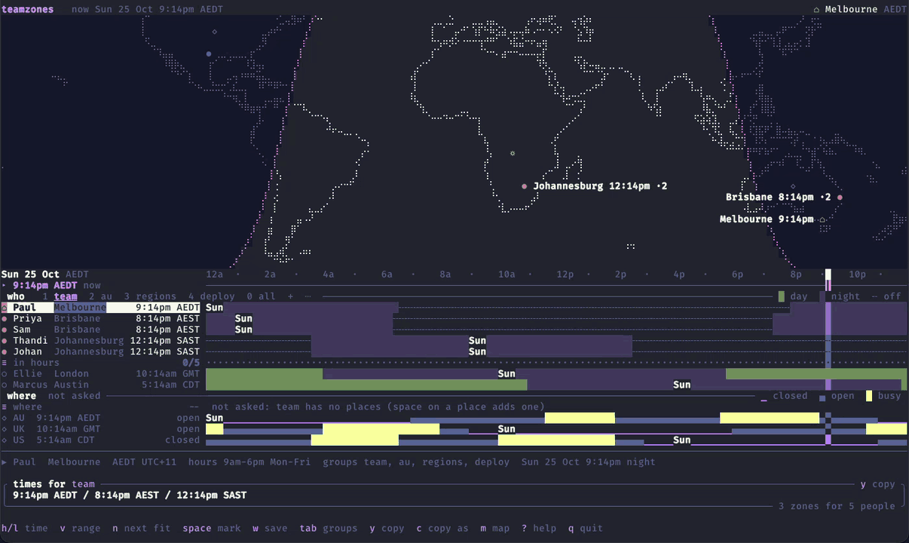
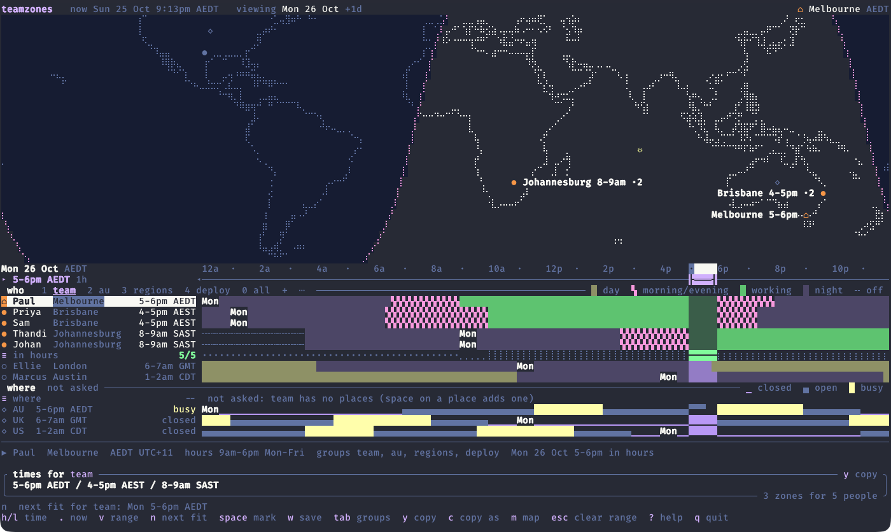
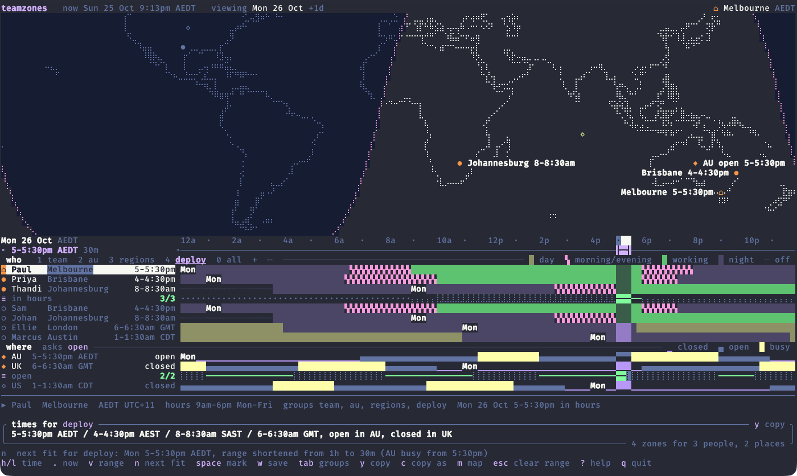

# teamzones

teamzones is a terminal app for picking a time across timezones. It puts your colleagues and the regions you operate in on one time axis in your home zone. It then finds the slots that work and copies the answer as one line you can paste into Slack.

Picking a time for a call across Melbourne, Brisbane and Johannesburg is a sum you do in your head. Picking one for a deploy adds a second question: is any region we trade in at its lunch or dinner rush? teamzones answers both. People are drawn by their working hours and daylight, places by how busy they are, and `n` jumps to the next slot where everyone a group counts is in hours and every place it counts is quiet enough. For example:

```
5-5:30pm AEDT / 4-4:30pm AEST / 8-8:30am SAST / 6-6:30am GMT, open in AU, closed in UK
```

The same answers are available from the command line with `teamzones say`, so they work in scripts and shell aliases too.



## Install

```sh
brew install paulchiu/tap/teamzones
```

Releases carry archives for macOS (Apple silicon and Intel) and Linux (x86_64). To build from a checkout instead:

```sh
cargo install --path crates/teamzones
```

## Set up your team

1. Run `teamzones config init` to write a commented template to `~/.config/teamzones/config.toml`.
2. Run `teamzones config edit` and fill in your home city, your colleagues, the regions you operate in and a few groups.
3. Run `teamzones config check`. It names the line of any mistake.
4. Run `teamzones` to open the TUI.

A person is a name, a city and their hours. A place is a zone and a trading profile (when it opens, and when it's busy). A group names the people and places to count, for example `team` for a stand-up or `deploy` for a release window. See [docs/configuration.md](docs/configuration.md) for a sample config.

To have a coding agent write the config for you, point it at [llms.txt](llms.txt). It lists every table and field, and tells the agent how to gather your colleagues' cities, zones and hours from tools such as Slack and your calendar.

## The screen



The ruler covers one day in your home zone. Under it, each person's lane shows their working hours, mornings and evenings, and night, with the people the group counts at the top and everyone else dimmed underneath. The places below show when each region is closed, open or busy. The box at the bottom holds the line `y` copies.

`h` and `l` move through the day, `[` and `]` move a day, `1` to `9` switch groups and `n` jumps to the next slot that works. `?` lists every key. On a wide, tall terminal a world map with the night side sits above the ruler, and on a small one the blocks fold so the answer rows and the times box stay in view.

A group can count places as well as people. Here `n` found Monday 5pm for the deploy group and shortened the slot to 30 minutes, since AU gets busy from 5:30pm:



`space` adds or removes the focused row from the group for a one-off question, and `w` saves the change. You can also add, edit and delete people and places from the screen; teamzones edits only the lines that changed, so your comments and layout in the config survive. See [docs/screen.md](docs/screen.md) for the full guide.

## `say`

`teamzones say` prints the line for a group and copies it to the clipboard. With the sample config, on a Saturday morning in Melbourne:

```
$ teamzones say team 3pm
3pm AEDT / 2pm AEST / 6am SAST
$ teamzones say apps 3pm
3pm AEDT / 5am BST / Fri 11pm CDT, open in AU, closed in UK and US
$ teamzones say deploy next
Mon 26 Oct, 5-5:30pm AEDT / 4-4:30pm AEST / 8-8:30am SAST / 6-6:30am GMT, open in AU, closed in UK
$ teamzones say team +@uk 5pm mon
5pm AEDT / 4pm AEST / 8am SAST / 6am GMT, closed in UK
$ teamzones say regions 2-4pm mon --zones
2-4pm AEDT / 3-5am GMT / Sun 10pm-12am CDT
```

A place adds its clock to the line and its state after the comma; `--zones` keeps the clocks and drops the states. `next` finds the next slot that works for the group. When you're travelling, `teamzones here London --until 2026-11-01` moves the axis to London until that date is over there.

## Limitations

- Hours are what you write in the config. teamzones doesn't read calendars or know about public holidays.
- A trading profile is your estimate of when a region opens and gets busy, not real load data.
- A place has one zone, so a region that spans several (such as the US) is drawn in the one you pick.
- teamzones doesn't notice when your system zone changes; use `teamzones here` when travelling.
- Keys can't be rebound.
- Releases are built for macOS and Linux only; there's no Windows build.

## Documentation

- [docs/configuration.md](docs/configuration.md): the config file, people, places, trading profiles, groups, travel and the theme.
- [docs/cli.md](docs/cli.md): every command, who-expressions, typed times and exit codes.
- [docs/screen.md](docs/screen.md): reading the screen, the keys, the mouse, small terminals and editing from the TUI.
- [docs/releasing.md](docs/releasing.md): the label, tag and Homebrew pipeline, and building from source.
- [docs/spec/](docs/spec/) is the product contract the tests read, and [docs/decisions.md](docs/decisions.md) records why it is the way it is.

## Development

See [AGENTS.md](AGENTS.md) for the dev loop and project conventions.

Run `just ci` before pushing. It runs the format check, lint, tests, docs build, core isolation check and build, the same recipe the GitHub workflow runs.

Every PR carries one of the labels `major`, `minor`, `patch` or `norelease`. On merge to `main`, the version-tag workflow bumps the version by that label, rolls the changelog and tags the release, and the tag publishes the archives and the Homebrew formula.

## Credits

City names, zones and coordinates come from [GeoNames](https://www.geonames.org/) (`cities15000`), used under [CC BY 4.0](https://creativecommons.org/licenses/by/4.0/).

## Licence

MIT. See [LICENSE](LICENSE).
